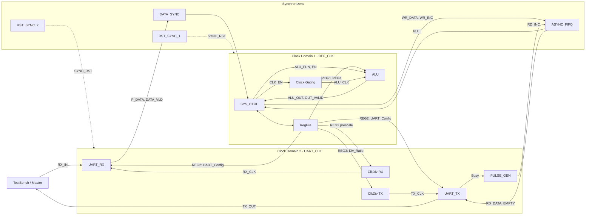

# ⚡ SYS_TOP: Low-Power Configurable Multi-Clock Digital System

**Send a byte. Get an answer. Cross two clock domains without dropping a single bit.** 🚀

An **RTL-to-GDS** project in Verilog / SystemVerilog: a UART-controlled system that takes commands from a master, crunches them with a **Register File** or a **16-bit-result ALU**, and ships the result back over **UART TX** through an **asynchronous FIFO**, so two very different clock rates never lose data.

---

## 🧭 Table of Contents

1. [Why It's Cool](#-why-its-cool)
2. [System Specs](#-system-specs)
3. [Architecture](#-architecture)
4. [Block Descriptions](#-block-descriptions)
5. [Register File Map](#-register-file-map)
6. [Command Protocol](#-command-protocol)
7. [ALU Functions](#-alu-functions)
8. [Sequence of Operation](#-sequence-of-operation)
9. [Repository Structure](#-repository-structure)
10. [Simulation](#-simulation)
11. [Backend Flow](#-backend-flow-synthesis--formality--dft)

---

## 🔥 Why It's Cool

- 🕒 **Two clock domains**: `REF_CLK` (50 MHz) and `UART_CLK` (3.6864 MHz) working together.
- 🔒 **Bulletproof CDC**: reset synchronizers, a pulse-based data synchronizer, and a Gray-code async FIFO.
- 🔋 **Low power by design**: the ALU clock is gated and only wakes up when there's real work to do.
- 🎛️ **Configurable on the fly**: parity enable/type, prescale and clock division ratio are all set through the Register File.
- 🧩 **Fully parameterized**: data width, register-file depth, synchronizer stages and FIFO depth.
- ✅ **Self-checking testbench**: task-based, driven purely through the UART pins like a real master.
- 🧪 **DFT-ready**: `SYS_TOP_dft.v` with 3 scan chains, scan muxes on clocks/resets, and a Formality-verified flow.

---

## 📊 System Specs

- ⏱️ Reference clock (`REF_CLK`): **50 MHz**
- ⏱️ UART clock (`UART_CLK`): **3.6864 MHz**
- 🟢 Clock divider enable: **always on** (`clk_div_en = 1`)
- 📡 Default UART: **115200 baud** (3.6864 MHz / 32), **parity enabled, even**
- 📦 Frame: 1 start bit, 8 data bits (LSB first), optional parity bit, 1 stop bit
- 🗄️ Data width 8 bits, Register File 16 x 8, ALU result 16 bits
- 🔄 Reset: active-low async input, synchronized separately into each domain

---

## 🏗️ Architecture

**10 blocks**, two clock domains, and a team of synchronizers keeping the peace between them.



---

## 🧱 Block Descriptions

### 🅰️ Clock Domain 1 (REF_CLK)

- 🗃️ **RegFile** (`Reg_File.v`): 16 x 8 register file. Registers 0-3 have dedicated outputs (`REG0`/`REG1` to the ALU, `REG2` to the UART, `REG3` to the clock dividers). Synchronous read with a `RdData_Valid` flag.
- 🧮 **ALU** (`Alu_unit.v`): arithmetic, logic, compare and shift operations on the gated clock, with a 16-bit result and an `OUT_VALID` flag.
- 🚪 **Clock Gating** (`CLK_Gating_unit.v`): latch-based, glitch-free gate (`ALU_CLK = REF_CLK & latched_enable`).
- 🧠 **SYS_CTRL** (`Sys_Ctrl_Unit.sv`): the brain. An FSM that decodes command frames, drives the RegFile and ALU, and pushes results into the FIFO. States: `IDLE`, `Recieve_RF_Wr_Addr`, `Recieve_RF_Wr_data`, `Recieve_RF_RD_Addr`, `Recieve_OP_A`, `Recieve_OP_B`, `Recieve_Alu_Fun`, `ALU_Excute`, `Send_to_fifo`.

### 🅱️ Clock Domain 2 (UART_CLK)

- 📤 **UART_TX** (`UART_TX_TOP.v`, `serializer_unit.v`, `Parity_Calc.v`, `MUX.v`, `Control_unit_FSM.sv`): serializes a byte into a full frame and raises `Busy` while sending.
- 📥 **UART_RX** (`Uart_RX_TOP.v`, `RX_FSM_control_unit.sv`, `edge_bit_cnt_unit.v`, `data_sampling_unit.v`, `deserializer_unit.v`, `strt_check_unit.v`, `parity_check_unit.v`, `stop_check_unit.v`): oversamples the line, rebuilds the byte, and flags parity and stop-bit errors.
- ⚡ **PULSE_GEN** (`pulse_gen_unit.v`): turns the TX `Busy` level into a single-cycle `RD_INC` pulse for the FIFO.
- 🕰️ **Clock Dividers** (`CLK_Div_Unit.v`, `CLK_Div_mux.v`): integer divider for odd and even ratios. One instance makes `TX_CLK` from `REG3`, another makes `RX_CLK` from the `REG2` prescale field.

### 🛡️ Synchronizers

- 🔁 **RST_SYNC** (`rst_sync_unit.v`): async assert, sync de-assert. One per domain.
- 🌉 **DATA_SYNC** (`Data_synchronizer.v`): multi-bit CDC from UART_CLK to REF_CLK using an enable-pulse scheme.
- 🚰 **ASYNC_FIFO** (`Async_FIFO_Top.v`, `FIFO_MEM_CNTRL.v`, `FIFO_WR.v`, `FIFO_RD.v`, `DF_SYNC.v`): depth-16 Gray-code pointer FIFO carrying results from REF_CLK to TX_CLK.

### 🔝 Top Level

- 🧬 **SYS_TOP** (`SYS_TOP.v`) wires everything together. `Uart_TOP.v` wraps UART_TX and UART_RX.

---

## 🗺️ Register File Map

- **0x0 → REG0**: ALU Operand A
- **0x1 → REG1**: ALU Operand B
- **0x2 → REG2**: UART configuration
  - `[0]` Parity Enable (default `1`)
  - `[1]` Parity Type (default `0` = even)
  - `[7:2]` Prescale (default `32`)
- **0x3 → REG3**: Clock division ratio (default `32`)
- **0x4 to 0x15**: general-purpose registers for normal read/write

> ⚠️ Addresses 0x0 to 0x3 are **reserved** for configuration and ALU operands.

---

## 📨 Command Protocol

Every frame is one byte, sent in order (Frame 0 first).

- ✍️ **Register File Write** (3 frames, no response)
  - Frame 0: `RF_Wr_CMD` = `0xAA`
  - Frame 1: Address
  - Frame 2: Data
- 👀 **Register File Read** (2 frames, 1-byte response)
  - Frame 0: `RF_Rd_CMD` = `0xBB`
  - Frame 1: Address
- 🧮 **ALU Operation with operands** (4 frames, 2-byte response)
  - Frame 0: `ALU_OPER_W_OP_CMD` = `0xCC`
  - Frame 1: Operand A
  - Frame 2: Operand B
  - Frame 3: ALU function
- ♻️ **ALU Operation with no operands** (2 frames, 2-byte response)
  - Frame 0: `ALU_OPER_W_NOP_CMD` = `0xDD`
  - Frame 1: ALU function (reuses the operands already in REG0/REG1)

ALU results are 16 bits, returned as two UART frames: **low byte first, then high byte**.

---

## 🧮 ALU Functions

As implemented in `Alu_unit.v` and mirrored by the testbench reference model:

- `0000` ➕ Addition
- `0001` ➖ Subtraction
- `0010` ✖️ Multiplication
- `0011` ➗ Division
- `0100` AND
- `0101` OR
- `0110` NAND
- `0111` NOR
- `1000` XOR
- `1001` XNOR
- `1010` CMP: A = B
- `1011` CMP: A > B
- `1100` CMP: A < B
- `1101` SHIFT: A >> 1
- `1110` SHIFT: A << 1

---

## 🔄 Sequence of Operation

This is the exact flow the testbench (`Sys_tb.v`) runs:

1. 🛠️ **Configure**: the master writes the Register File at addresses `0x2` (UART config) and `0x3` (division ratio).
2. 🎯 **Command**: the master (testbench) fires off different commands, both RegFile operations and ALU operations.
3. 📥 **Receive**: frames arrive on `UART_RX` and travel through the data synchronizer to `SYS_CTRL`.
4. ⚙️ **Execute**: the operation runs on the ALU or the RegFile.
5. 📤 **Respond**: `SYS_CTRL` pushes the result into the async FIFO and `UART_TX` sends it back to the master.

Address ranges:

- ✅ **0x4 to 0x15**: normal write/read operations
- 🔒 **0x0 to 0x3**: reserved for configuration and ALU operands

---

## 📁 Repository Structure

```
.
├── SYS_TOP.v                  # Top level
├── Sys_Ctrl_Unit.sv           # SYS_CTRL FSM
├── Reg_File.v                 # Register file
├── Alu_unit.v                 # ALU
├── CLK_Gating_unit.v          # ALU clock gate
├── CLK_Div_Unit.v             # Integer clock divider
├── CLK_Div_mux.v              # Prescale -> RX divider ratio
├── pulse_gen_unit.v           # Level-to-pulse generator
├── rst_sync_unit.v            # Reset synchronizer
├── Data_synchronizer.v        # Multi-bit CDC (enable-pulse scheme)
├── Async_FIFO_Top.v           # Async FIFO top
│   ├── FIFO_MEM_CNTRL.v
│   ├── FIFO_WR.v
│   ├── FIFO_RD.v
│   └── DF_SYNC.v
├── Uart_TOP.v                 # UART wrapper
│   ├── UART_TX_TOP.v  (Control_unit_FSM.sv, serializer_unit.v, Parity_Calc.v, MUX.v)
│   └── Uart_RX_TOP.v  (RX_FSM_control_unit.sv, edge_bit_cnt_unit.v, data_sampling_unit.v,
│                       deserializer_unit.v, strt_check_unit.v, parity_check_unit.v,
│                       stop_check_unit.v)
├── Sys_tb.v                   # Task-based testbench
└── Final_System.pdf           # Specification
```

---

## 🧪 Simulation

`Sys_tb.v` talks to the DUT **only through the UART pins**, just like a real master would.

**Tasks**

- `send_uart_byte`: bit-bangs one frame (start, 8 data bits LSB first, parity if enabled, stop)
- `recv_uart_byte`: samples one frame from `o_TX_OUT_sys`
- `rf_write`: command `0xAA`
- `rf_read_and_check`: command `0xBB` plus response compare
- `alu_op_and_check`: command `0xCC` plus 2-byte response compare
- `alu_nop_and_check`: command `0xDD` plus 2-byte response compare

An `alu_model` reference function computes the expected results, and every transaction prints `PASS` or `FAIL` with a final summary. 🎉

**Run it (QuestaSim / ModelSim example)**

```bash
vlog *.v *.sv
vsim -c Sys_tb -do "run -all; quit"
```

Swap in the equivalent commands for VCS, Xcelium, or any SystemVerilog-capable simulator.

---

## 🏭 Backend Flow (Synthesis → Formality → DFT)

### 1️⃣ Synthesis

Constraints in `cons.tcl`:

- Master clocks: `REF_CLK` (50 MHz), `UART_CLK` (3.686 MHz)
- Generated clocks: `ALU_CLK` (REF_CLK, /1), `RX_CLK` (UART_CLK, /1), `TX_CLK` (UART_CLK, /32)
- Clock uncertainty: 0.2 ns setup, 0.1 ns hold; clock transition 0.05 ns on master clocks
- `set_dont_touch` on all master and generated clocks, plus clock grouping
- Input delays (all inputs except CLK/RST) and output delays (all outputs): 20% of the clock period
- Buffer driving cell on inputs (except CLK/RST), 0.1 pF load on outputs
- Operating conditions from slow and fast libraries

✔️ Checks: no errors, loops or latches in `syn.log`, and no setup or hold violations.

### 2️⃣ Formality post-synthesis

Formality must succeed with **zero failing points**.

### 3️⃣ DFT

- Build `SYS_TOP_dft.v` with scan ports (`scan_clk`, `scan_rst`, `test_mode`, `SE`, `SI[NUM_OF_CHAINS-1:0]`, `SO[NUM_OF_CHAINS-1:0]`, `NUM_OF_CHAINS = 3`) and muxes on the clock and reset ports.
- Add scan constraints to `cons.tcl`: scan clock via `create_clock`, `SCAN_CLK` clock group, 20% input/output delays on `SI`/`SE`/`SO`, driving cells on `SI`/`SE`, 0.1 pF load on `SO`, and `set_case_analysis 1 [get_port test_mode]`.
- DFT script sections: architect scan chains, define DFT signals, create test protocol, pre-DFT DRC, preview DFT, insert DFT, post-DFT DRC.

✔️ Checks: no errors, loops or latches in `dft.log`, no setup/hold violations, and **DFT coverage > 98%**.

### 4️⃣ Formality post-DFT

Formality must succeed with **zero failing points**. 🏁

---

## 👤 Author

**Youssef**, 3rd-year Electronics and Communications Engineering student, Helwan University / Capital University, Cairo.
🔗 LinkedIn: https://linkedin.com/in/youssef-ahmed-galal
